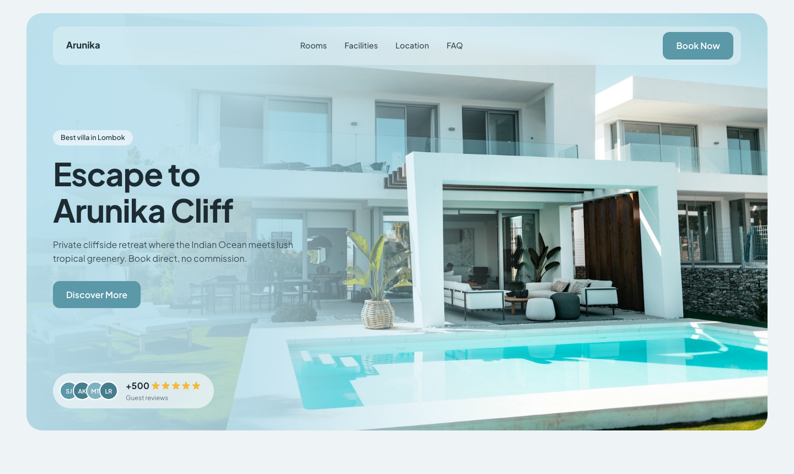
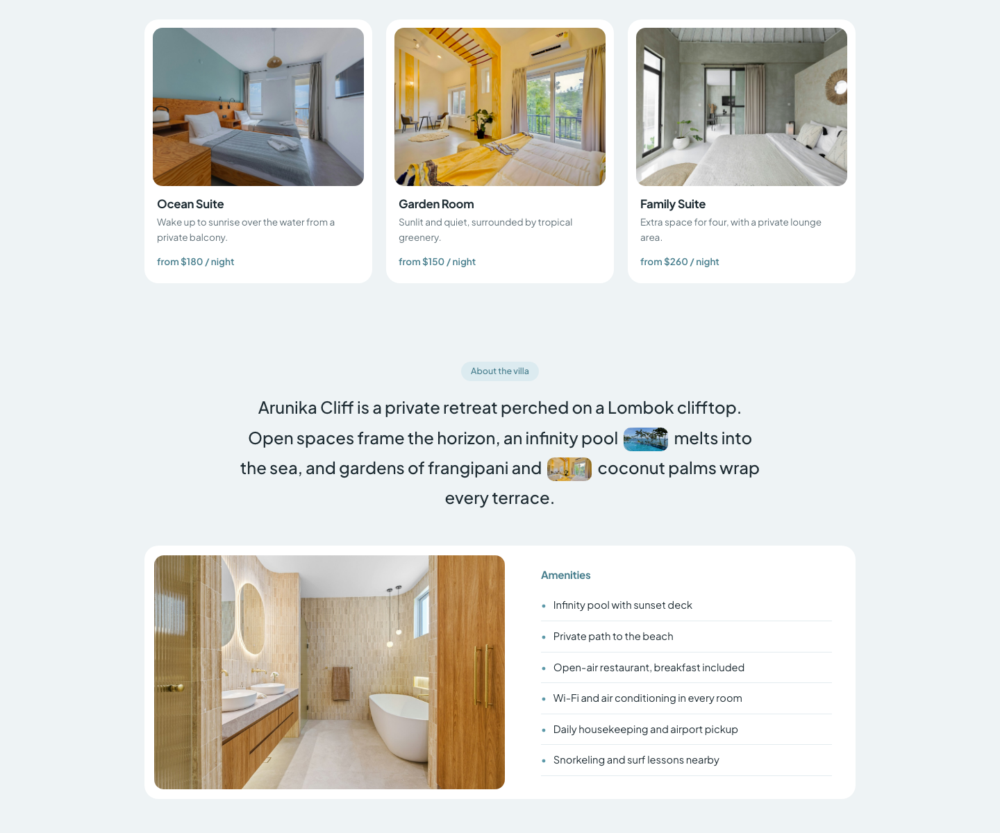
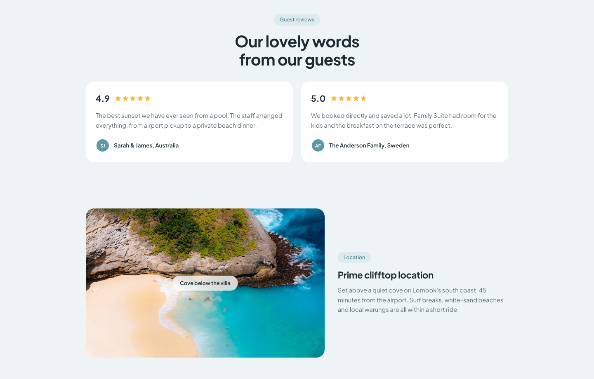
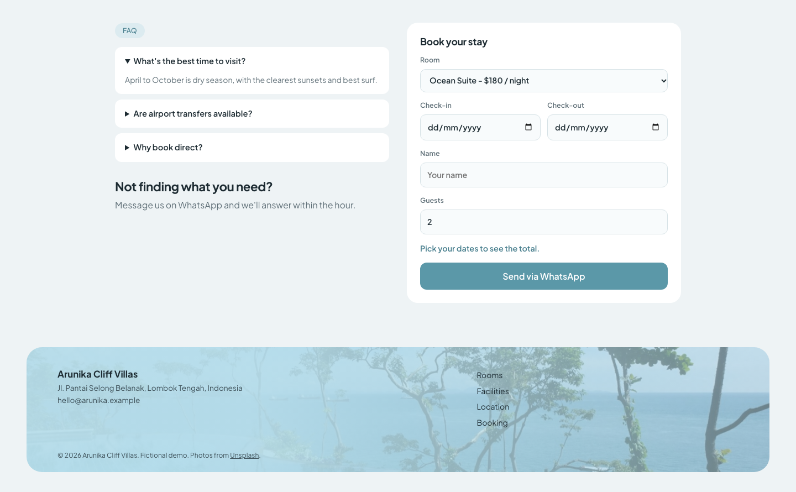
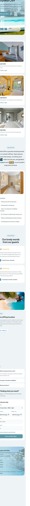

# Arunika Cliff Villas

A direct-booking landing page for a fictional cliffside villa in Lombok, Indonesia.
Built as a template small hospitality businesses could use to **skip OTA commissions**
and take bookings straight to WhatsApp.

> Fictional demo. Not a real property. Photos from Unsplash (see [credits](images/CREDITS.md)).



## The problem it solves

Small villas lose 15-20% of every booking to OTA platforms. This page lets a guest pick a
room, choose dates, see the total, and send a ready-made booking message to the owner on
WhatsApp, with no backend, no payment gateway, and no monthly fee.

## Features

- **Booking calculator**: nights x nightly rate for the chosen room, with date validation
  (check-out must be after check-in).
- **WhatsApp handoff**: builds a prefilled `wa.me` message with room, dates, guests, total and name.
- **Responsive**: desktop grid collapses to a single column; mobile menu with accessible toggle.
- **Scroll reveal** via `IntersectionObserver`, disabled under `prefers-reduced-motion`.
- **Native HTML where possible**: `<details>` for the FAQ, `<input type="date">` for dates,
  no UI libraries.
- Zero dependencies, no build step. Three files: `index.html`, `style.css`, `script.js`.

## Screenshots

| Rooms & amenities | Reviews & location |
|---|---|
|  |  |

| FAQ & booking | Mobile |
|---|---|
|  |  |

## Run locally

```bash
python3 -m http.server 8000
# open http://localhost:8000
```

Any static server works; it is plain HTML/CSS/JS.

## Customize for a client

1. Set the WhatsApp number in `script.js` (`WHATSAPP`, international format, no `+`).
2. Edit room names and rates in the `<select>` in `index.html` (the `data-price` attribute drives the total).
3. Replace photos in `images/` and update the address, email and map `src`.

## Notes

- The map is a keyless Google Maps embed; swap the query for the real location.
- Reviews and the "+500" badge are placeholder copy for the demo.

## Stack

HTML, CSS (custom properties, grid), vanilla JavaScript. Font: Plus Jakarta Sans.
